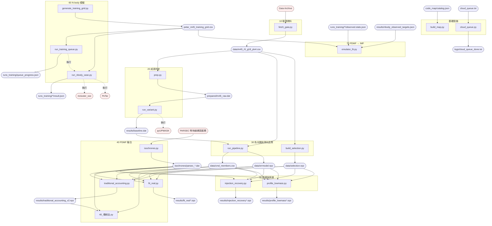

<!-- 由 code_map/build_map.py 依 catalog.json 生成，請勿手改 -->

# 資料流程圖

方框是程式，圓角框是檔案（藍色在 repo 內，紅色是外部來源或外部程式）。實線箭頭是讀寫檔案，虛線是一支程式執行另一支。箭頭完全由 catalog.json 的 reads／writes／calls 決定；只被 import、自己不讀寫檔案的函式庫不在圖上，見 [每支程式的上下游](views/relations.md)。

